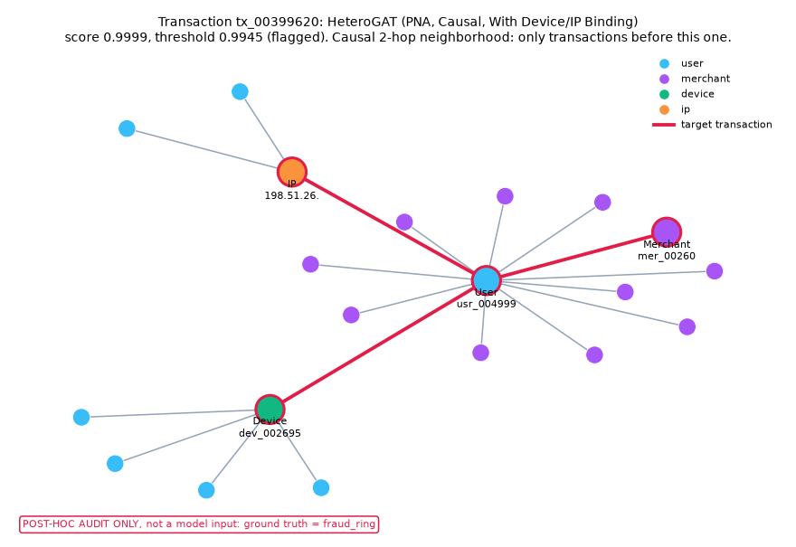

# Explanation Evaluation

Generated by `scripts/make_explanation_examples.py` (settings in `configs/explain.yaml`). Do not edit by hand.

For each model and fraud type, up to 50 random true positives (seed 42) are explained **with that model only**. Labels and fraud types are used only to pick and group the cases, never as explainer inputs.

**Deletion test:** remove the explanation's top 3 risk-raising attributions together and compare the drop in score with removing 3 random attributions of the same model (mean of 5 draws). XGBoost features are replaced by their training-split median; HeteroGAT components (device/IP embedding, edge-feature groups) are removed. *Faithful* = the top-k drop is larger than the random drop. Cases with no risk-raising attribution are not tested.

## XGBoost + Label-Free Graph Features

| Fraud type | Explained / TPs available | Faithful (k/n tested) | Mean drop, top-k | Mean drop, random-k | Most common top attribution | Median ms per explanation |
|---|---|---|---|---|---|---|
| fraud_ring | 50/83 | 50/50 | 0.8341 | 0.0785 | `two_hop_ip_users` (30/50) | 7.2 |
| account_takeover | 50/72 | 50/50 | 0.8630 | 0.0674 | `ip_distinct_users` (40/50) | 7.3 |
| merchant_collusion | 50/51 | 50/50 | 0.8358 | 0.0831 | `ip_distinct_users` (37/50) | 7.2 |
| card_testing | 50/113 | 50/50 | 0.8603 | 0.1479 | `time_delta_card` (43/50) | 8.2 |
| mule | 47/47 | 47/47 | 0.7165 | 0.0778 | `time_delta_card` (43/47) | 8.1 |

## HeteroGAT (PNA, Causal, With Device/IP Binding)

| Fraud type | Explained / TPs available | Faithful (k/n tested) | Mean drop, top-k | Mean drop, random-k | Most common top attribution | Median ms per explanation |
|---|---|---|---|---|---|---|
| fraud_ring | 50/140 | 50/50 | 0.2047 | 0.0246 | `historical_merchant` (35/50) | 386.0 |
| account_takeover | 50/55 | 50/50 | 0.1678 | 0.0196 | `ip_binding` (33/50) | 321.3 |
| merchant_collusion | 50/54 | 50/50 | 0.2323 | 0.0329 | `ip_binding` (29/50) | 382.3 |
| card_testing | 50/92 | 50/50 | 0.4963 | 0.0617 | `card_velocity` (26/50) | 386.5 |
| mule | 15/15 | 15/15 | 0.7223 | 0.0937 | `time_delta` (7/15) | 361.3 |

## Static example

The fraud type is a post-hoc label shown for auditing only; it is not a model input.

## One example per model and fraud type

### XGBoost + Label-Free Graph Features: `tx_00399620` (fraud_ring, post-hoc label)

> Transaction tx_00399620 scored 0.943 with XGBoost + Label-Free Graph Features; its validation-selected threshold is 0.760.
> Distinct accounts seen on this IP before the transaction: 2.00 (training median 3.00); this raises the model score (SHAP +1.454 log-odds).
> Other accounts reachable through this IP (2 hops): 2.00 (training median 2.00); this raises the model score (SHAP +0.925 log-odds).
> Feature 'device_user_count_past': 5.00 (training median 4.00); this raises the model score (SHAP +0.608 log-odds).
> SHAP values are relative to the model's average log-odds (+0.202) and add up to this transaction's score.

Neighborhood view: [tx_tx_00399620_xgb_lf_fraud_ring.html](tx_tx_00399620_xgb_lf_fraud_ring.html)

### XGBoost + Label-Free Graph Features: `tx_00399482` (account_takeover, post-hoc label)

> Transaction tx_00399482 scored 0.989 with XGBoost + Label-Free Graph Features; its validation-selected threshold is 0.760.
> Distinct accounts seen on this IP before the transaction: 1.00 (training median 3.00); this raises the model score (SHAP +2.244 log-odds).
> Feature 'hour_cos': 0.97 (training median -0.50); this raises the model score (SHAP +0.579 log-odds).
> Distinct accounts seen on this device before the transaction: 3.00 (training median 3.00); this raises the model score (SHAP +0.482 log-odds).
> SHAP values are relative to the model's average log-odds (+0.202) and add up to this transaction's score.

Neighborhood view: [tx_tx_00399482_xgb_lf_account_takeover.html](tx_tx_00399482_xgb_lf_account_takeover.html)

### XGBoost + Label-Free Graph Features: `tx_00399840` (merchant_collusion, post-hoc label)

> Transaction tx_00399840 scored 0.899 with XGBoost + Label-Free Graph Features; its validation-selected threshold is 0.760.
> Distinct accounts seen on this IP before the transaction: 2.00 (training median 3.00); this raises the model score (SHAP +1.294 log-odds).
> Other accounts reachable through this IP (2 hops): 2.00 (training median 2.00); this raises the model score (SHAP +0.869 log-odds).
> Feature 'device_user_count_past': 5.00 (training median 4.00); this raises the model score (SHAP +0.642 log-odds).
> SHAP values are relative to the model's average log-odds (+0.202) and add up to this transaction's score.

Neighborhood view: [tx_tx_00399840_xgb_lf_merchant_collusion.html](tx_tx_00399840_xgb_lf_merchant_collusion.html)

### XGBoost + Label-Free Graph Features: `tx_00401496` (card_testing, post-hoc label)

> Transaction tx_00401496 scored 0.971 with XGBoost + Label-Free Graph Features; its validation-selected threshold is 0.760.
> Seconds since the card's previous transaction: 19.00 (training median 92,723.00); this raises the model score (SHAP +3.227 log-odds).
> Feature 'log_time_delta_card': 3.00 (training median 11.44); this raises the model score (SHAP +0.906 log-odds).
> Pulling the other way: Feature 'hour_cos': -1.00 (training median -0.50); this lowers the model score (SHAP -0.583 log-odds).
> SHAP values are relative to the model's average log-odds (+0.202) and add up to this transaction's score.

Neighborhood view: [tx_tx_00401496_xgb_lf_card_testing.html](tx_tx_00401496_xgb_lf_card_testing.html)

### XGBoost + Label-Free Graph Features: `tx_00399518` (mule, post-hoc label)

> Transaction tx_00399518 scored 0.887 with XGBoost + Label-Free Graph Features; its validation-selected threshold is 0.760.
> Seconds since the card's previous transaction: 932.00 (training median 92,723.00); this raises the model score (SHAP +1.199 log-odds).
> Feature 'hour_cos': 0.97 (training median -0.50); this raises the model score (SHAP +0.832 log-odds).
> Card transactions in the previous 24 hours: 3.00 (training median 0.00); this raises the model score (SHAP +0.678 log-odds).
> SHAP values are relative to the model's average log-odds (+0.202) and add up to this transaction's score.

Neighborhood view: [tx_tx_00399518_xgb_lf_mule.html](tx_tx_00399518_xgb_lf_mule.html)

### HeteroGAT (PNA, Causal, With Device/IP Binding): `tx_00399620` (fraud_ring, post-hoc label)

> Transaction tx_00399620 scored 1.000 with HeteroGAT (PNA, Causal, With Device/IP Binding) on its own causal subgraph; its validation-selected threshold is 0.995.
> Removing the IP embedding bound to the decoder lowers the score by 0.001.
> Removing the time-of-day and day-of-week features lowers the score by 0.000.
> Each change is measured with one component removed at a time; changes are not additive.

Neighborhood view: [tx_tx_00399620_gat_bind_fraud_ring.html](tx_tx_00399620_gat_bind_fraud_ring.html)

### HeteroGAT (PNA, Causal, With Device/IP Binding): `tx_00399482` (account_takeover, post-hoc label)

> Transaction tx_00399482 scored 1.000 with HeteroGAT (PNA, Causal, With Device/IP Binding) on its own causal subgraph; its validation-selected threshold is 0.995.
> Removing the IP embedding bound to the decoder lowers the score by 0.004.
> Removing the device embedding bound to the decoder lowers the score by 0.002.
> Each change is measured with one component removed at a time; changes are not additive.

Neighborhood view: [tx_tx_00399482_gat_bind_account_takeover.html](tx_tx_00399482_gat_bind_account_takeover.html)

### HeteroGAT (PNA, Causal, With Device/IP Binding): `tx_00402530` (merchant_collusion, post-hoc label)

> Transaction tx_00402530 scored 0.999 with HeteroGAT (PNA, Causal, With Device/IP Binding) on its own causal subgraph; its validation-selected threshold is 0.995.
> Removing the IP embedding bound to the decoder lowers the score by 0.037.
> Removing the device embedding bound to the decoder lowers the score by 0.004.
> Each change is measured with one component removed at a time; changes are not additive.

Neighborhood view: [tx_tx_00402530_gat_bind_merchant_collusion.html](tx_tx_00402530_gat_bind_merchant_collusion.html)

### HeteroGAT (PNA, Causal, With Device/IP Binding): `tx_00403006` (card_testing, post-hoc label)

> Transaction tx_00403006 scored 0.999 with HeteroGAT (PNA, Causal, With Device/IP Binding) on its own causal subgraph; its validation-selected threshold is 0.995.
> Removing the card velocity features lowers the score by 0.193.
> Removing the time-since-previous-transaction features lowers the score by 0.021.
> Each change is measured with one component removed at a time; changes are not additive.

Neighborhood view: [tx_tx_00403006_gat_bind_card_testing.html](tx_tx_00403006_gat_bind_card_testing.html)

### HeteroGAT (PNA, Causal, With Device/IP Binding): `tx_00399518` (mule, post-hoc label)

> Transaction tx_00399518 scored 0.997 with HeteroGAT (PNA, Causal, With Device/IP Binding) on its own causal subgraph; its validation-selected threshold is 0.995.
> Removing the time-since-previous-transaction features lowers the score by 0.046.
> Removing the time-of-day and day-of-week features lowers the score by 0.019.
> Each change is measured with one component removed at a time; changes are not additive.

Neighborhood view: [tx_tx_00399518_gat_bind_mule.html](tx_tx_00399518_gat_bind_mule.html)

## Limitations

- The deletion test checks that the named attributions matter *to the model*; it does not show that they match the simulator's fraud mechanism.
- SHAP deletion uses the training median as the 'removed' value; other reference choices can give different drops.
- HeteroGAT deltas are one-at-a-time and not additive. Each explanation scores the transaction on its own causal subgraph, the same input as the isolated batched test scores used to select true positives.
- Timings are single-process CPU wall-clock on this machine.
